> 作品集：[tidegale.github.io](https://tidegale.github.io/) — 两个项目的实现、实测数据和没做完的部分都在这一页

> 开发日志：[docs/开发日志.md](docs/开发日志.md) — 按天记的推进和卡点


# RK3568 视频采集与推流终端

在 RK3568 开发板上打通一条从 USB 摄像头到浏览器的实时视频链路：采集、解耦、本地预览、HTTP 推流、抓拍、状态查询，全部自己实现。

## 为什么做这个项目

之前的项目都在应用层：界面、协议、文件传输，数据是别人准备好的。这个项目从摄像头一路打到网络，中间每一层都自己管——V4L2 的缓冲、多线程的同步、协议的细节、网络的异常、长时间运行的资源占用。

目标不是把画面显示出来，而是**把一条实时数据链路做稳，并且能说清每一处为什么这么设计**。

## 功能与状态

| 编号 | 功能 | 说明 | 状态 |
|---|---|---|---|
| F1 | 实时采集 | USB 摄像头，V4L2 mmap 四缓冲，实测 15.1fps | 完成 |
| F2 | 本地预览 | 写 framebuffer，板子屏幕实时显示 | 完成 |
| F3 | 网络推流 | HTTP MJPEG，浏览器直接观看 | 完成 |
| F4 | 远程抓拍 | HTTP 请求存一张 JPEG，返回路径和大小 | 完成 |
| F5 | 状态查询 | 帧率、丢帧、连接数、运行时长、内存占用 | 完成 |
| F6 | 异常恢复 | 客户端断开不崩、摄像头拔掉自动重连 | 完成 |
| F7 | 常开录音 | ALSA 采集，每 3 秒一段，检测到人声才落盘 | 完成 |
| F8 | 语音识别 | 录音段落送云端转文字 | 完成 |
| F9 | 语音触发动作 | 说"拍一张"就抓帧存文件 | 完成 |
| F10 | 看图回答 | 说"桌上有什么"，抓帧送多模态模型回答 | 完成 |
| F11 | 语音播报 | 把回答念出来 | 完成 |

F7 到 F10 是 v2.0 新增的一层：**让设备能听见、能听懂、能回答**。定位没变——端侧只做数据通路，重计算全部上云。

开发步骤：

| 步骤 | 内容 | 状态 |
|---|---|---|
| 1 | 串口登录，确认板子型号和内核版本 | 完成 |
| 2 | 交叉编译加 SSH 传输链路 | 完成 |
| 3 | V4L2 设备能力探测 | 完成 |
| 4 | 采集第一帧 | 完成 |
| 5 | 连续采集与帧率统计 | 完成 |
| 6 | 环形缓冲与三线程解耦 | 完成 |
| 7 | HTTP MJPEG 推流 | 完成 |
| 8 | framebuffer 本地预览 | 完成 |
| 9 | 抓拍与状态接口 | 完成 |
| 10 | 异常恢复、多客户端、断流重连 | 完成 |
| 11 | 压测与文档 | 完成 |
| 12 | ALSA 音频采集，人声门限 | 完成 |
| 13 | 交叉编译 openssl/curl，云端接入 | 完成 |
| 14 | 语音线程：ASR → 意图 → 抓帧 → 回答 | 完成 |
| 15 | TTS 语音播报 | 完成 |

## 硬件与软件

| 项 | 内容 |
|---|---|
| 开发板 | RK3568（RK3568B2，LPDDR4，8GB eMMC） |
| 屏幕 | 1024x600，32bpp，stride 4096，`/dev/fb0` |
| 摄像头 | Logitech C270（046d:0825），USB UVC 免驱，MJPEG |
| 系统 | Linux 4.19.232 aarch64 |
| 交叉编译 | gcc-linaro 7.5.0 aarch64-linux-gnu |


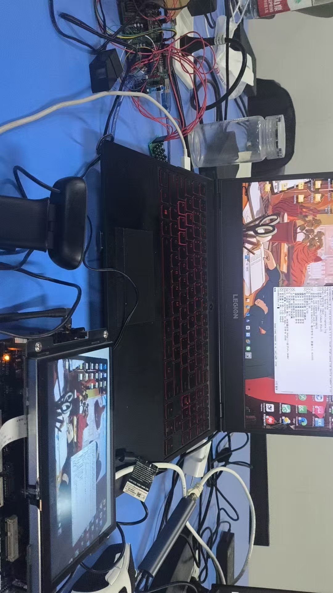
*framebuffer 直接写屏，和推流同源*

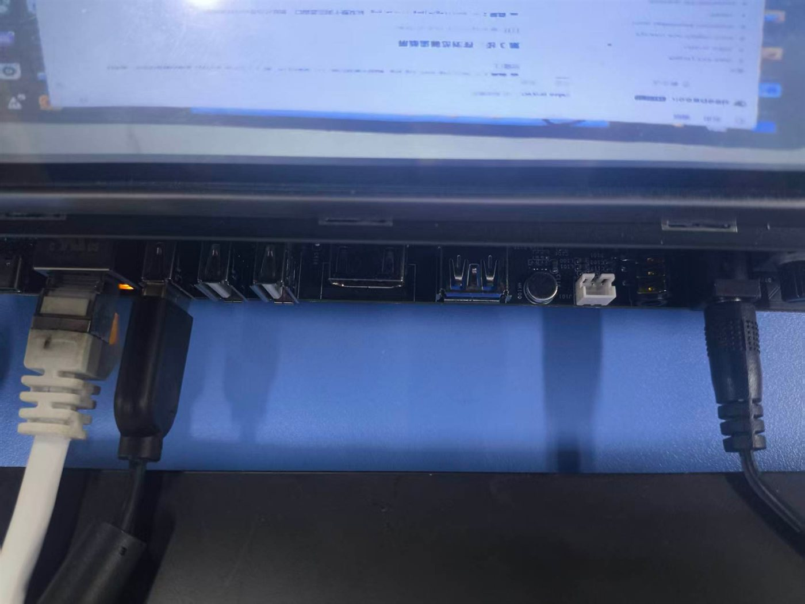
*摄像头插在板子 USB 口上，UVC 免驱识别*

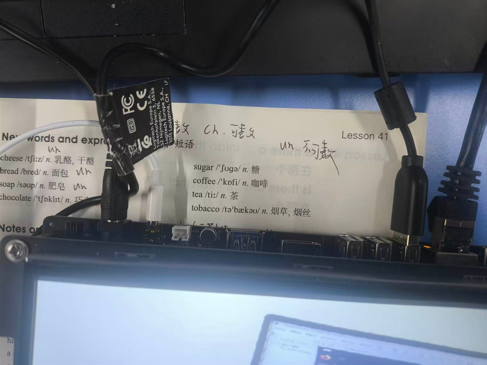
*USB 声卡插在板子另一个 USB 口上，2.0 的语音输入从这里进*

### 构建环境

| 项 | 内容 |
|---|---|
| 目标平台 | aarch64 Linux 4.19.232（板卡出厂内核，未自己编内核） |
| 编译器 | gcc-linaro 7.5.0，`aarch64-linux-gnu-gcc` |
| 构建系统 | Makefile（v1.0 时代是单条 gcc，v2.0 起迁到 Makefile，见下面「编译」） |
| 运行时依赖 | libc、`pthread`、`libm`；alsa/curl/openssl 静态链进二进制，板子上不用另装 |
| 第三方代码 | `stb_image.h` v2.31、`cJSON` 1.7.19，源码放在 `third_party/` 里，不联网取依赖 |
| 上板验证 | 2026-11，RK3568B2（8GB eMMC）+ Logitech C270 |

## 目录结构

```
rk3568-video-stream/
├── src/
│   ├── probe.c          V4L2 设备能力探测：驱动名、支持格式、分辨率
│   ├── capture.c        主程序：采集线程、设备重连、两条队列的分发
│   ├── ringbuf.c        环形缓冲：定长槽位、满丢最旧、丢帧计数
│   ├── network.c        HTTP 服务：MJPEG 推流、/status、/capture
│   ├── preview.c        framebuffer 预览：软件解码、缩放、写屏
│   ├── audio.c          ALSA 采集：常开录音，按人声落盘（v2.0）
│   ├── voice.c          语音交互：识别 → 意图 → 抓帧 → 回答（v2.0）
│   ├── httpclient.c     HTTPS 请求与密钥配置（v2.0）
│   ├── ai.c             云端能力：语音识别、看图回答（v2.0）
│   ├── aitest.c         云端接口的验证工具，四个子命令（v2.0）
│   └── audiorec.c       独立录音小工具，用来造测试 wav（v2.0）
├── include/             上面这些模块的头文件
├── third_party/
│   ├── stb_image.h      JPEG 解码（v2.31，单头文件）
│   └── cJSON.c/.h       JSON 解析（1.7.19，单文件）
├── docs/                开发日志、实拍图、实测数据
└── Makefile
```

## 编译

```bash
make                # 编 capture（主程序）
make aitest         # 编云端接口验证工具
make audiorec       # 编独立录音工具，造测试 wav 用
make probe          # 编设备探针
make clean          # 清产物
```

默认用 `aarch64-linux-gnu-gcc`，两个第三方库前缀在 Makefile 顶部，换机器只改那两行：

```bash
ALSA_PREFIX ?= $(HOME)/mylib/arm-alsa     # alsa-lib
AI_PREFIX   ?= $(HOME)/mylib/arm-ai       # curl + openssl
```

也可以命令行覆盖：`make ALSA_PREFIX=/opt/alsa AI_PREFIX=/opt/ai`。

**为什么从单条 gcc 迁到 Makefile**：v1.0 只有 5 个文件、一个 `-lm`，一条命令敲得完。v2.0 加到 11 个源文件，还要链接 alsa、curl、openssl 三套交叉编译出来的库，命令行已经长到一屏放不下，参数顺序错了报错还很难看懂。用 Makefile 把链接顺序固定下来，也顺手做到增量编译。

`-lm` 仍然不能漏：`stb_image.h` 的 HDR 分支用到 `pow`。链接顺序是 `-lcurl -lssl -lcrypto` 在前、`-lm -lpthread` 在后，Makefile 里已经排好。

## 运行

```bash
scp capture root@<板子IP>:/root/
ssh root@<板子IP> "/root/capture /dev/videoN MJPG /root/frame 100000"
```

参数：`<设备节点> <像素格式> <输出前缀> <帧数> [宽x高]`

- 设备节点不固定，重启后可能变。查法：
  ```bash
  for f in /sys/class/video4linux/video*; do echo "$f: $(cat $f/name)"; done
  ```
  找名字带 `UVC Camera` 的那个，别用 `rkisp_*` 虚拟节点。
- 可选分辨率的最后一个参数写 `640x480` 这样，不写默认 1280x720。

### v2.0 的额外准备

语音那条链路要麦克风通路、云端密钥、根证书三样，缺一样程序都不报错——只是录音全静音，或者识别一直失败。这是这套代码最阴的地方，第一次上板务必按顺序做完：

```bash
# 板子上：麦克风通路 + 录音落盘目录
amixer -c 0 sset 'Capture MIC Path' 'Main Mic'
mkdir -p /root/audio_rec
```

```bash
# 电脑上：传密钥和根证书
ssh root@<板子IP> "mkdir -p /root/.config && chmod 700 /root/.config"
scp aikey root@<板子IP>:/root/.config/aikey
ssh root@<板子IP> "chmod 600 /root/.config/aikey"
scp /etc/ssl/certs/ca-certificates.crt root@<板子IP>:/root/cacert.pem
```

`aikey` 四行，`api_key` 自己保管，不进仓库（`.gitignore` 里已经挡了 `aikey` 和 `cacert.pem`）：

```
base_url=https://dashscope.aliyuncs.com/compatible-mode/v1
api_key=sk-...（自己填）
model=qwen3-vl-plus
ca_path=/root/cacert.pem
```

长跑必须挂后台，前台跑会把调试串口占死：

```bash
nohup /root/capture /dev/video9 MJPG /root/frame 100000 > /root/capture.log 2>&1 &
```


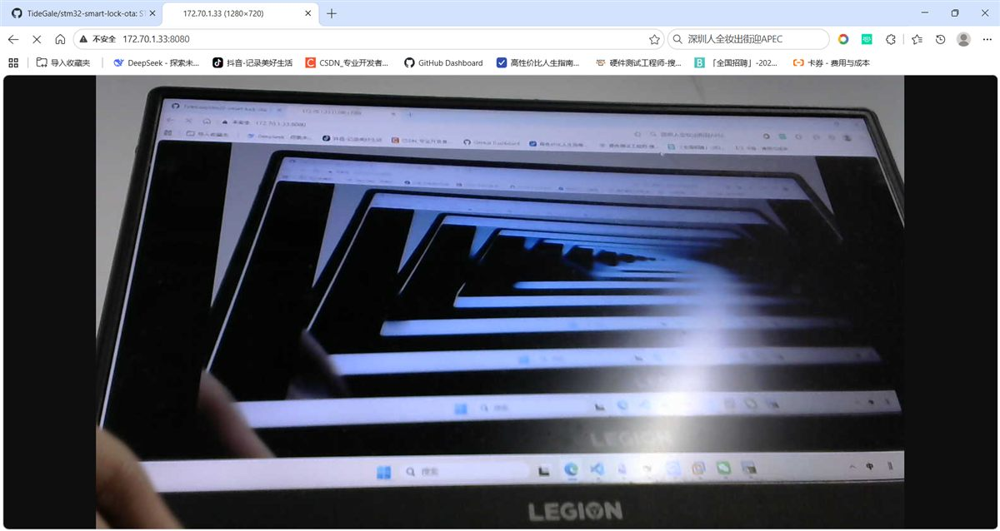
*手机对着屏幕拍的，画面是浏览器里正在播放的 MJPEG 流*

## 访问

| 路径 | 说明 |
|---|---|
| `http://<板子IP>:8080/` | 浏览器直接看实时画面（MJPEG 流） |
| `/status` | 返回 JSON 状态 |
| `/capture` | 存一张当前帧，返回路径和字节数 |

```bash
$ wget -qO- http://172.70.1.33:8080/status
{"fps":15.0,"frames":1105,"drop_stream":0,"drop_preview":0,"clients":0,"uptime":77,"rss":6476}

$ wget -qO- http://172.70.1.33:8080/capture
/root/snap_822.jpg 45311
```

字段：窗口帧率、已采帧数、推流队列丢帧、预览队列丢帧、客户端数、运行秒数、常驻内存 KB。

## 关键设计

**为什么中间要有环形缓冲**：采集和消费速度不匹配。15fps 是摄像头定的，消费端可能更快也可能更慢。队列吸收速度差，慢的丢最旧的帧，采集永远不被拖住。定长槽位，满了丢最旧不丢最新——视频要的是现在，不是两秒前。

**为什么两条队列，不做一队列多消费者**：一条队列取走就没了，两个线程各抢会各拿一半帧，画面都缺。拆成两条，采集端复制两份，推流和预览各吃各的，谁慢谁丢自己的。

**为什么一帧广播给所有客户端**：帧从队列里只取一次，遍历客户端列表写给每个人。开销是带宽，不是数据完整性。

**为什么 MJPEG 不选 RTSP**：MJPEG 不用编码器，摄像头直接出 JPEG，两天能通。RTSP 要 H.264、要 MPP 那套媒体框架，优先级排在链路通之后。

**为什么软件解码还要补哈夫曼表**：UVC 摄像头出的 MJPEG 省略了 DHT 段，指望解码器用内置默认表。`stb_image` 没有内置表，所以自己在帧头补了 432 字节的标准表（从 libjpeg 生成的 JPEG 里原样取出）。

**为什么慢客户端直接踢掉**：给每个 socket 设 1 秒发送超时，超时就断开。牺牲慢客户端，换整体不阻塞。真要伺候慢客户端，得给每个人配独立队列，那是另一种量级的工程。

**为什么摄像头重连要重建整套资源**：`mmap` 的映射跟设备 fd 绑定，fd 一关映射就失效。重连必须关流、解映射、关 fd、重开、重新申请、重新映射、重新入队、重新开流。

**为什么音频要常开而不是按键触发**：真实产品都是常开（智能音箱一直听）。常开的代价是绝大部分时间是废话，解法不是关录音，而是**每 3 秒判断一次，没人声就不落盘**。按 1% 说话时间估算，一天约 27 MB；不判断的话是 2.7 GB，两天写满 eMMC。

**为什么语音识别单独一条线程**：识别一次要几百毫秒到几秒，放在录音线程里会让采样断流。现在是录音线程只做采样和入队，语音线程慢慢处理，两边互不阻塞。**这也是单生产者单消费者、队列满了覆盖最旧的那一套**——用户连着说两句时，前一句作废比排队积压合理。

**为什么用字符串匹配判断意图，不用模型**：说"拍一张"必须立刻响应。指令类的话要快、要确定，字符串匹配没有延迟也不会犹豫；只有真正的问题才交给模型。

**为什么回答限三十字**：文字最终要念出来。模型默认会答一百多字，念二十秒。这不是模型不好，是没告诉它约束。


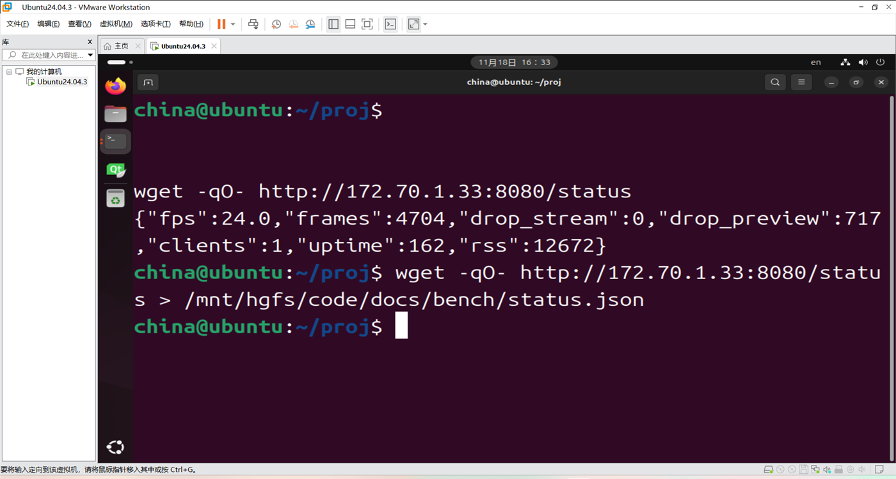
*`/status` 的原始返回：fps、frames、drop 计数、rss 都在里面*

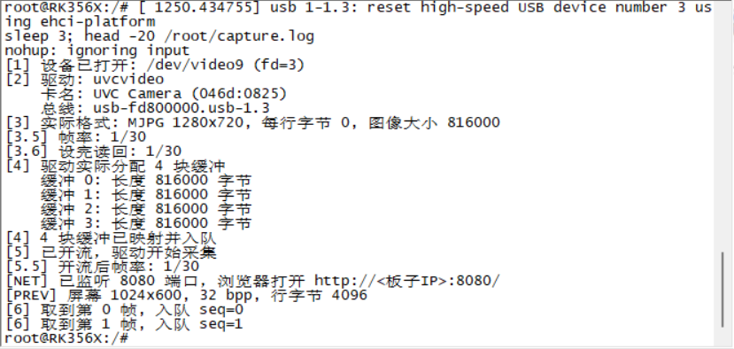
*退出时打印的累计统计，帧序号连着没断*

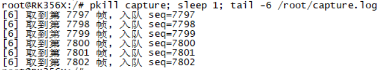
*从打开驱动到四缓冲入队、开始采集的完整过程*

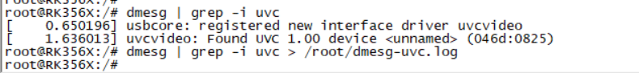
*摄像头是内核 UVC 驱动认出来的，不是私有协议*

## 实测指标

### 帧率

连续采集 300 帧，数据来自程序自己的时间戳统计：

| 分辨率 | 帧大小 | 平均帧率 | 平均间隔 | 最大间隔 | 最小间隔 |
|---|---|---|---|---|---|
| 1280x720 MJPG | 约 41 KB | 15.1 fps | 66.4 ms | 68.4 ms | 63.9 ms |
| 640x480 MJPG | 约 18 KB | 15.1 fps | 66.4 ms | 68.4 ms | 63.9 ms |

**这颗摄像头实际输出固定 15fps，不是代码问题，也不是带宽问题。** 排查过程：

| # | 查什么 | 结果 |
|---|---|---|
| 1 | 硬件声明支持哪些帧率（`VIDIOC_ENUM_FRAMEINTERVALS`） | 720p 和 640x480 都列了 30fps |
| 2 | `VIDIOC_S_PARM` 设 30fps | 成功 |
| 3 | `VIDIOC_G_PARM` 设完读回 | `1/30`，驱动确实记下了 |
| 4 | `VIDIOC_G_PARM` 开流后读回 | `1/30`，UVC 协商没有偷改 |
| 5 | USB 协商速度 | 480 Mbps（USB 2.0 高速），带宽充足 |
| 6 | `dmesg` 看驱动日志 | 无带宽或传输错误 |
| 7 | 降到 640x480 重测 | **帧率完全不变，仍 15.1fps** |

第 7 条是关键：分辨率降到四分之一、帧大小降到一半，速度纹丝不动，说明瓶颈不在 USB 链路，而在摄像头固件。66.4ms 的间隔非常规整（最大最小只差 4.5ms），是摄像头内部定时器的固定节拍。

**驱动认为自己在跑 30fps，硬件按 15fps 出数据。** 这是 UVC 1.00 老协议设备的已知行为，用户态改不了。

### 稳定性（连续 32.8 分钟）

每 5 秒采一次 `/status`，共 393 个采样点：

| 指标 | 结果 |
|---|---|
| 内存（rss） | 11616 KB 起步，一次性升到 12148 KB，之后 342 个采样点（约 28 分钟）**纹丝不动** |
| 推流丢帧 | 全程 0 |
| 进程 | 未退出，无 oops |

那 532 KB 的增长不是泄漏，是**一次性到位**：`ring_put` 反复 `malloc`/`free` 同尺寸的块，glibc 分配器把释放的内存留在自己的池子里不还给系统，RSS 停在最高水位。判泄漏看的是「是否持续单调上涨」，这里是「跳一次然后一平到底」。

### CPU

| 分辨率 | 单核占用 | 预览丢帧 | 说明 |
|---|---|---|---|
| 1280x720 | 约 61% | 累计 1277 | 四核合计约 15% |
| 640x480 | 约 47% | 0 | 画面清晰可辨 |

像素面积少了四倍，CPU 只降两成，说明**瓶颈不在 JPEG 解码**，而在 `draw_rgb` 那个缩放写屏循环：不管源图多大，输出固定 1024x576，每帧 59 万次像素写入，加上 2.36 MB 显存写，这部分开销跟源分辨率无关。

降分辨率真正的收益是 `drop_preview` 从 1277 变成 0——预览跟得上了。

### 语音链路（v2.0）

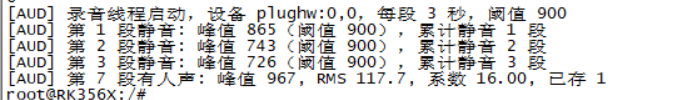
*安静段峰值 865/743/726，人声 967，阈值 900 —— 这个门限是量出来的*

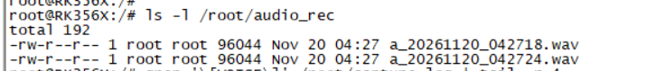
*每段 96044 字节，正好 3 秒 16k 单声道*

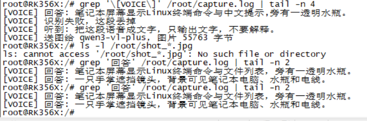
*说「桌上有什么」，链路走完 ASR → 抓帧 → 多模态回答*

## 已知限制

**帧率被摄像头固件锁在 15fps。** 用户态改不了，见上面排查表。

**单广播线程，慢客户端靠超时踢掉。** 一个客户端不读数据，1 秒后断开它，其它人不受影响。代价是网络抖动时可能误踢，浏览器会自动重连。

**软件解码加缩放吃单核四到六成。** 优化方向不是换解码库（分析表明解码不是大头），而是缩放循环：跳行采样、整数移位、或只在画面变化时写显存。

**本地预览没有双缓冲。** 写显存写到一半碰上屏幕刷新会撕裂，15fps 下不明显。真要治得上显存双缓冲加 panning。

**语音交互依赖云端。** 断网时录音照常落盘，但不会识别、不会回答。端侧没有本地模型——A55 四核算力不够，这是主动取舍。

**人声门限是拍出来的常数。** 900 来自这块板子实测（安静时峰值约 1000，说话 3000 以上）。换麦克风要重新测，不是通用值。

**`Capture MIC Path` 每次开机重置。** 必须在启动前执行 `amixer -c 0 sset 'Capture MIC Path' 'Main Mic'`，否则录音全是静音而程序不报错。

## 踩过的坑（摘要）

| 坑 | 现象 | 根因 |
|---|---|---|
| MJPEG 缺 DHT | `stb` 报 `expected marker`，屏幕全黑 | 摄像头省了哈夫曼表，`stb` 无内置默认表 |
| 32 位屏全黑 | 日志正常，屏幕不亮 | alpha 位没填满，驱动当透明处理 |
| 屏幕被占 | 我们的画面被盖住 | 板子自带 demo 开机自启，抢同一个 fb0 |
| 设备节点漂移 | `open: No such file or directory` | 摄像头每次枚举编号不固定 |
| 8080 连不上 | `Connection refused` | `main` 里漏了 `net_start` 调用 |
| 慢客户端拖死全部 | 一个卡，所有客户端都不出画面 | 阻塞 `send`，没设发送超时 |
| 录音全是静音 | 峰值只有几十，程序不报错 | 开机后 `Capture MIC Path` 复位成 `MIC OFF` |
| 安静时不停触发 | 云端被"嗯"刷屏 | 人声门限 300 太低，噪声峰值就有上千 |
| 交叉编译 SSL 失败 | `unsupported ARM architecture` | openssl 用 `--cross-compile-prefix`，不是 `--host` |

## 许可

MIT，见 `LICENSE`。